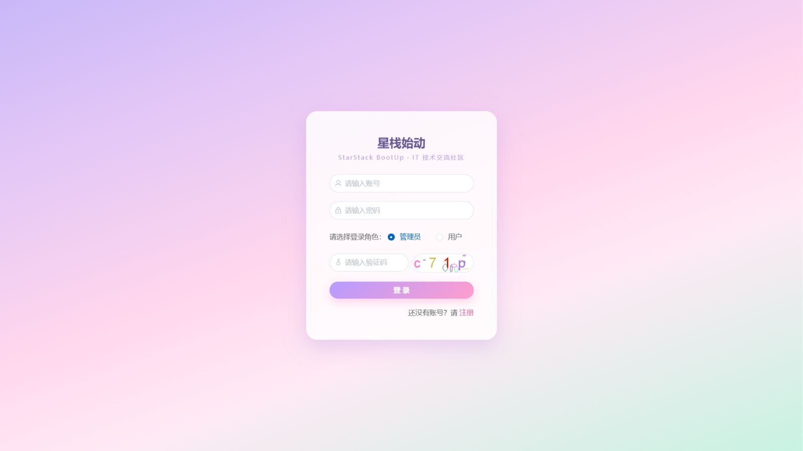
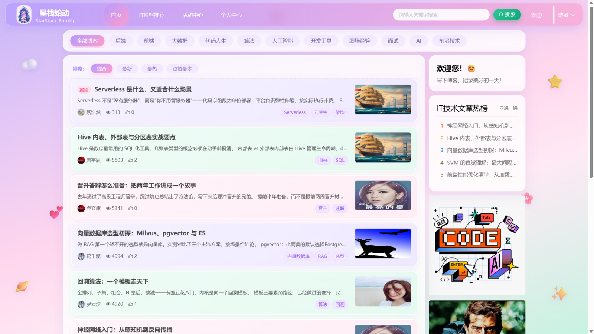
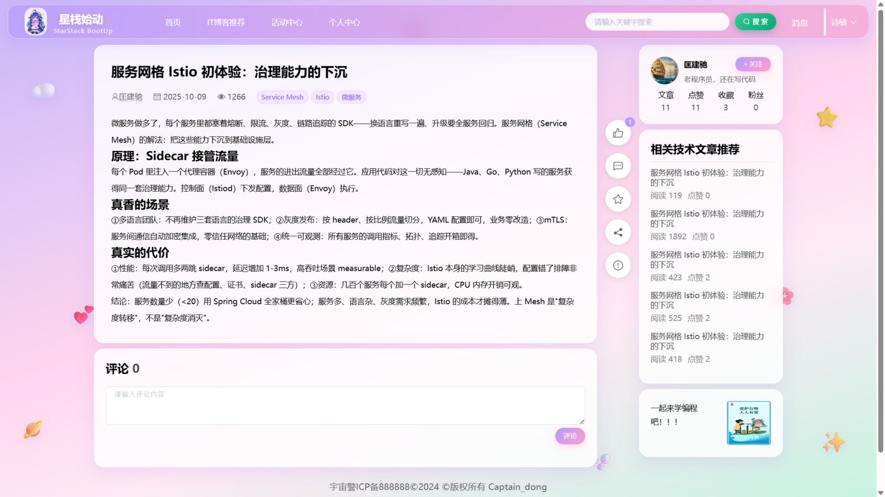
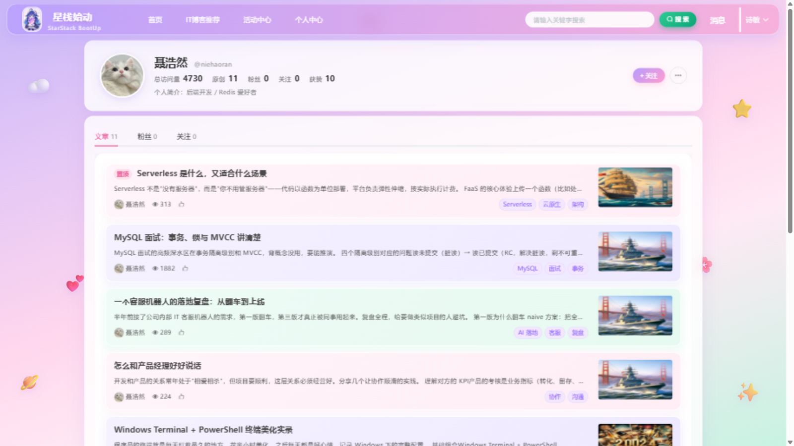
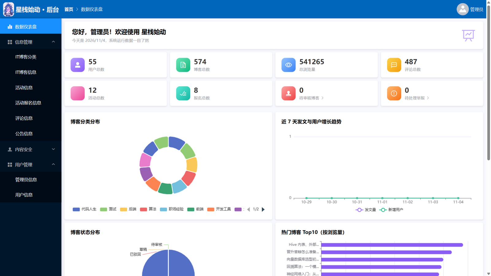
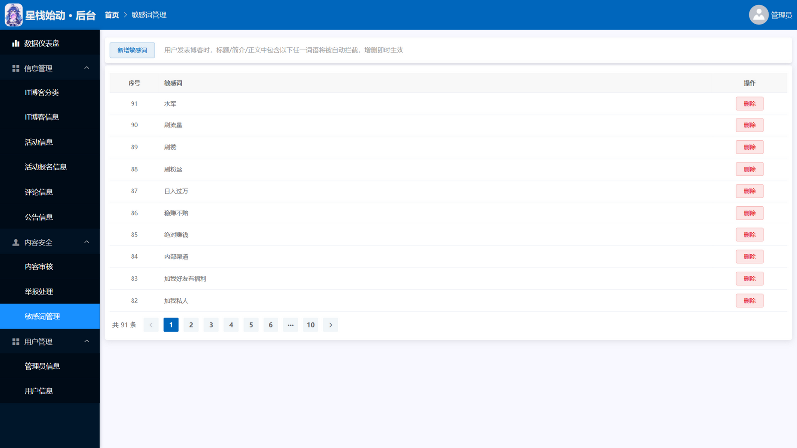

# 星栈始动 StarStack BootUp

> 一个基于 Spring Boot & Vue 的 IT 技术交流社区 —— 写下代码与梦想，在这里始动你的技术之路。


## ✨ 项目简介

星栈始动是一个面向 IT 学习者与开发者的全栈技术交流社区，覆盖从**内容创作、内容消费到社区互动、内容治理**的完整闭环：

- **博客创作**：富文本编辑、封面上传、草稿箱、公开/私人可见性
- **内容安全**：发布内容经"敏感词自动拦截 + 管理员人工审核"双重机制，支持举报与处理闭环
- **社区互动**：点赞、收藏、评论、关注与粉丝、私信聊天、向作者提问（一问一答）
- **个性化推荐**：基于用户行为评分矩阵与余弦相似度的 User-Based 协同过滤推荐
- **个人空间**：访问量、原创、粉丝、关注、获赞等数据统计
- **消息通知**：点赞、收藏、评论、关注、审核结果、举报结果、活动等全站事件提醒
- **数据仪表盘**：分类分布、发文与用户增长趋势、状态分布、热门博客 Top10 可视化（管理端）

## 📸 系统预览

### 前台用户端

| 登录页 | 首页（分类导航 + 博客列表） |
|:---:|:---:|
|  |  |
| **博客详情（悬浮工具栏 + 作者卡）** | **个人空间（数据统计 + 文章/粉丝/关注）** |
|  |  |

### 后台管理端

| 数据仪表盘 | 敏感词管理 |
|:---:|:---:|
|  |  |

## 📚 文档

- [架构设计文档](docs/ARCHITECTURE.md) —— 整体架构、数据模型与关键设计（审核状态机 / WebSocket 推送 / 图片三级缓存 / 协同过滤 / 安全设计）
- [API 接口文档](docs/API.md) —— 全量端点清单、统一返回结构与错误码表、限流策略
- [贡献指南](CONTRIBUTING.md) —— 环境搭建、提交规范与代码安全规约

## 🛠 技术栈

| 端 | 技术 |
|---|---|
| 后端 | Spring Boot 2.5 · MyBatis · PageHelper · JWT · BCrypt · Hutool |
| 前端 | Vue 2.6 · Element UI · wangEditor · ECharts |
| 数据库 | MySQL 8.0（17 张数据表） |

## 🚀 快速开始

### 环境要求

- JDK 1.8+
- Node.js 14+
- MySQL 8.0+

### 1. 初始化数据库

创建数据库 `xm-blog`（字符集 utf8mb4），按顺序导入以下脚本：

```bash
mysql -u root -p xm-blog < xm-blog.sql
mysql -u root -p xm-blog < xm-blog-upgrade-v2.sql
mysql -u root -p xm-blog < xm-blog-upgrade-v2.1.sql
mysql -u root -p xm-blog < xm-blog-upgrade-v2.2.sql
```

### 2. 配置并启动后端（端口 9090）

修改 `springboot/src/main/resources/application.yml` 中的数据库连接信息，然后：

```bash
cd springboot
mvn spring-boot:run
```

### 3. 启动前端（端口 8080）

```bash
cd vue
npm install
npm run serve
```

访问 http://localhost:8080 即可使用。内置管理员账号见 `xm-blog.sql`，部署后请立即修改密码。

## 🔒 安全特性

- BCrypt 自适应哈希密码存储，杜绝明文泄露
- JWT 无状态认证，修改密码即强制下线
- 图形验证码 + 连续登录失败 5 次锁定
- 敏感词自动拦截 + 人工审核双重内容安全机制
- 完整的举报与处理闭环，违规内容可下架并通知双方

## 🗂 目录结构

```
├── springboot/                # 后端 Spring Boot 工程
│   └── src/main/resources/
│       ├── application.yml    # 后端配置（端口 9090 / 数据库）
│       └── mapper/            # MyBatis XML 映射
├── vue/                       # 前端 Vue 工程
│   └── src/                   # 前台 + 管理后台页面
├── xm-blog.sql                # 数据库初始化脚本
├── xm-blog-upgrade-v2*.sql    # 历史版本升级脚本
├── build-all.bat              # 一键构建脚本（Windows）
└── thesis/ 说明               # 相关设计文档见仓库发布页
```

## 📄 开源协议

本项目基于 [MIT License](LICENSE) 开源，欢迎 Fork 与 Star ⭐
