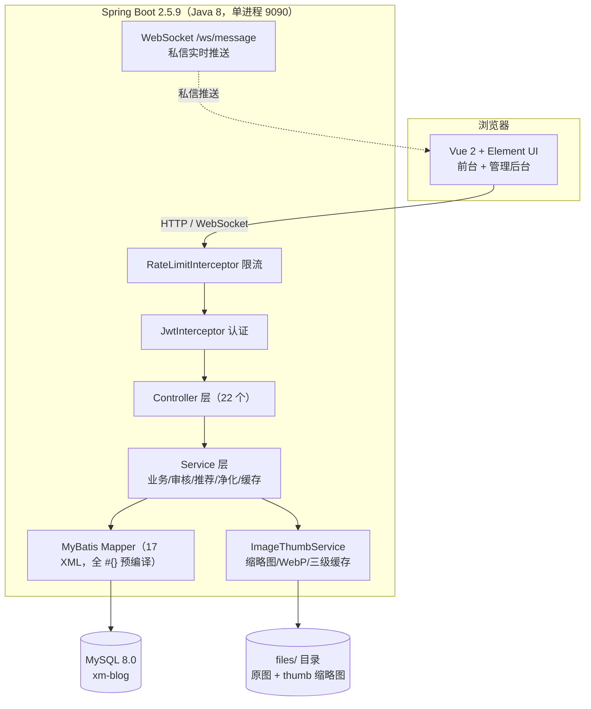

# 星栈始动 StarStack BootUp — 架构设计文档

> 本文面向希望理解系统内部设计的开发者，描述整体架构、数据模型与关键设计决策。

## 1. 系统概览

前后端分离单体架构，前端构建产物嵌入后端 `static/`，单端口 9090 对外提供服务。



## 2. 技术栈

| 层 | 技术 | 版本 | 用途 |
|---|---|---|---|
| 后端框架 | Spring Boot | 2.5.9 | Web / WebSocket / Cache |
| 持久层 | MyBatis + PageHelper | 2.2.1 / 1.4.6 | SQL 全 XML 预编译 |
| 认证 | java-jwt（HS256） | 4.3.0 | 无状态 Token，2h 时效 |
| 本地缓存 | Caffeine | 2.9.3 | 查询缓存 + 图片字节缓存 + 限流计数 |
| 图片处理 | Thumbnailator + webp-imageio | 0.4.20 / 0.1.6 | 缩略图 + WebP 编码 |
| HTML 消毒 | jsoup | 1.15.3 | 富文本 XSS 白名单过滤 |
| 工具库 | Hutool | 5.8.18 | 验证码/文件/加解密 |
| 数据库 | MySQL | 8.0 | utf8mb4 |
| 前端 | Vue 2 + Element UI + ECharts + wangEditor | 2.6.14 / 2.15.14 | SPA（history 路由） |

## 3. 分层与目录结构

```
springboot/src/main/java/com/example
├── controller/       # 22 个 Controller，113 个端点（详见 docs/API.md）
├── service/          # 业务逻辑：审核、推荐、净化、缓存、限流计数等
├── mapper/           # MyBatis 接口（XML 在 resources/mapper/）
├── entity/           # 18 个实体（Account 体系 + 业务实体）
├── common/
│   ├── config/       # WebConfig（拦截器/静态资源）、WebSocketConfig、CacheConfig
│   ├── ratelimit/    # @RateLimit 注解 + RateLimitInterceptor
│   ├── enums/        # ResultCodeEnum 错误码、RoleEnum、LikesModuleEnum
│   └── Result.java   # 统一返回 { code, msg, data }
├── exception/        # CustomException + GlobalExceptionHandler（@ControllerAdvice）
└── handler/          # MessageWebSocketHandler（私信推送）
```

## 4. 数据模型

核心域 18 张表（`xm-blog.sql` 含全量建表）：

| 域 | 表 | 说明 |
|---|---|---|
| 账号 | user / admin | Account 体系（密码 BCrypt，admin 密码哈希登录时透明升级） |
| 内容 | blog / category / activity | blog 带审核状态机与可见性；content 为富文本 HTML |
| 互动 | likes / collect / comment | 多模块复用（fid + module = BLOG/ACTIVITY）；comment 两级树形（pid/rootId） |
| 社交 | follow / message / question | 关注关系；私信（WebSocket 推送）；一问一答（WAIT/ANSWERED） |
| 运营 | notice / activitySign | 公告（登录弹窗告知）；活动报名 |
| 治理 | report / sensitiveWord / notification | 举报闭环（PENDING→RESOLVED/DISMISSED）；敏感词内存缓存；站内通知（8 种类型） |
| 推荐 | user_behavior | 行为矩阵（浏览=1/点赞=2/收藏=3 加权），协同过滤数据源 |

## 5. 关键设计

### 5.1 博客审核状态机
```
DRAFT --提交--> PENDING --审核通过--> PUBLISHED
                  |                        |
                  +--驳回(REJECTED, 含 rejectReason)
草稿/待审/驳回/私人 仅作者与管理员可见（scope 过滤，selectById 5015 拦截）
```
发布前过敏感词（内存缓存即时生效）+ XSS 白名单消毒。

### 5.2 认证与权限
- 登录签发 JWT（HS256），**签名密钥 = 用户当前密码哈希**——修改密码即强制全端下线；aud 载荷 `id-ROLE`，2 小时时效
- JwtInterceptor `/**` 拦截 + 白名单放行（登录/注册/验证码/游客只读接口清单见 WebConfig）
- 代码层二次角色校验：USER 专属（发布/评论/点赞）、ADMIN 专属（审核/仪表盘/敏感词）
- **AdminInterceptor**：对 /admin/**、用户/分类/活动/公告/报名记录的管理端接口统一 ADMIN 校验（非 ADMIN 403）；/user/update 校验「本人或 ADMIN」防水平越权；DELETE /files 防目录穿越 + ADMIN 收紧

### 5.3 私信 WebSocket 实时推送
```
发送方 HTTP POST /message/send → 落库 → MessageWebSocketHandler.pushToUser(receiverId)
接收方 /ws/message?token=JWT（握手期鉴权）→ onmessage 收到 {type:"new-message"}
前端 NotificationBell 持有全局连接（5s 自动重连），$bus 广播到聊天页
```
消息正文始终走 HTTP 落库保证可靠性，WebSocket 只承载轻量信号（推送 + ping/pong 心跳）。

### 5.4 图片三级缓存
```
请求 /files/thumb/{flag}
  ① Caffeine 内存字节缓存（32MB 重量上限，1h 访问过期）
  ② 磁盘 files/thumb/（与原图同名）
  ③ 现场生成：thumbnailator 缩放 ≤480px + WebP(q=0.8)，异常回退 JPEG，GIF 直通
原图 /files/{flag}：流式输出（不整读进堆）+ Cache-Control immutable 一年
```
实测单图 3.1MB → 27.9KB（112 倍），列表流量降 99%。上传即预热，删除联动清理。

### 5.5 协同过滤推荐
user_behavior 记录浏览/点赞/收藏行为 → User-CF 余弦相似度找相似用户 → 推荐其高互动内容（RecommendationService，`/recommend/user/{userId}`）。

### 5.6 接口限流
`@RateLimit(name, limit, window)` 注解 + 拦截器：按「维度名 + 客户端 IP」Caffeine 固定窗口计数，超限抛 5019。覆盖登录/注册/验证码/评论/提问/私信/举报/发布/上传/点赞/关注/阅读量（阈值见 docs/API.md）。

### 5.7 XSS 净化与 SQL 安全
- **富文本**（blog/activity.content）：jsoup `Safelist.relaxed()` 白名单消毒（剔除 script/iframe/on* 事件，保留排版/图片/音视频），草稿同样处理
- **纯文本**（评论/私信/提问/举报/公告/昵称/简介）：入库前 `HtmlUtil.escape` 转义
- **SQL**：全 XML `#{}` 预编译（零 `${}`）、like 用 `concat('%',#{},'%')`、排序 `<choose>` 白名单、JDBC 无 `allowMultiQueries`

## 6. 部署形态

前端 `npm run build` 产物复制到 `static/` 打进 jar；`user.dir/files/` 存上传文件（启动目录即文件根）；9090 直连（无 Nginx），WebSocket 无需额外代理。建议 JVM 参数：`-Xms256M -Xmx512M -XX:MaxMetaspaceSize=128M -XX:+UseSerialGC`（2C2G 服务器实测）。
